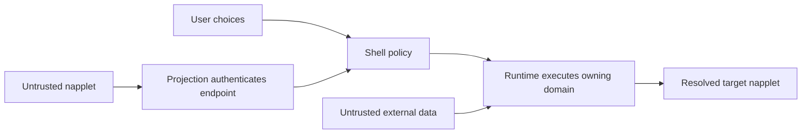

# NAP threat model

**Interoperability risk:** recommendation parsing and serialization in the current
[NAP-INTENT](naps/NAP-INTENT.md) contain conflicting requirements. The controls
for those paths need contract reconciliation before a conformance claim.
[PR #106](https://github.com/napplet/naps/pull/106) tracks that work.

This document models threats at the capability seam. It indexes existing
controls and proposes verification cases; it is not a new capability or a claim
that implementations have passed those cases. Baseline: naps commit
`e5308ac92cfd49e4fb026812c60886571515e219`.

## Assets and actors

| Asset | Protect from | Responsible boundary |
|-------|--------------|----------------------|
| User choices, handler defaults, and workspace composition | A napplet selecting or changing tools without authorization | User preferences mediated by shell policy |
| Signing keys, wallet credentials, and privileged operations | Untrusted code acquiring raw authority or turning the shell into a deputy | Shell mediation and per-napplet policy |
| Verified manifest/artifact identity and live endpoints | Caller identity claims, stale identities, and artifact substitution | Runtime verification and projection authentication |
| Payloads, identity data, and capability grants | Delivery to unrelated napplets or broader access than policy permits | Owning domain and authenticated endpoint scope |
| Cross-implementation agreement | Incompatible parsers, duplicated schemas, and implicit dependencies | Owning NAP contracts and projections |
| Runtime availability and lifecycle state | Floods, orphaned channels, and dropped accepted work | Runtime policy within each domain's contract |

The user chooses; the shell mediates; the runtime executes; napplets request.
A publisher, resource server, relay, or gateway can supply untrusted data.
A trusted runtime still needs verification: bugs in its authentication, routing,
or bindings can cross the seam even when its operator is well intentioned.

## Trust boundaries

The diagram names responsibilities, not required separate processes. The web
projection binds these responsibilities to authenticated browser endpoints;
other hosts supply their own projection. Manifest and artifact verification
precede executing the napplet. Neither a request payload nor readiness signal
can establish its own identity.

## Threats, controls, and evidence

| ID | Abuse case | Existing control and owner | Negative verification |
|----|------------|----------------------------|-----------------------|
| T-01 | An unknown endpoint impersonates a loaded napplet. | [Web identity binding](projections/web.md#identity--trust); [NAP-SHELL behavior](naps/NAP-SHELL.md#shell-behavior). | Send from an unmapped browser window; confirm no operation executes and no authenticated identity is created. |
| T-02 | A caller supplies another napplet's sender or peer identifier. | [INC topic routing](naps/NAP-INC.md#topic-routing), [channel management](naps/NAP-INC.md#channel-management), [intent runtime behavior](naps/NAP-INTENT.md#runtime-behavior). | Forge provenance fields. Confirm rejection or replacement with runtime-attested provenance; never forward the forged value as authority. |
| T-03 | Two publishers share a `d` value, or a replacement endpoint inherits an old channel. | [INC schemas](naps/NAP-INC.md#schemas); [intent catalog identifiers](naps/NAP-INTENT.md#catalog-identifiers). | Load colliding names and simultaneous instances; replace a peer. Check identities remain distinct and the old channel becomes terminal. |
| T-04 | `R`, `O`, role, or intent advertisements widen capabilities. | [Manifest catalog contract](naps/NAP-INTENT.md#manifest-catalog-contract); [NAP-SHELL security](naps/NAP-SHELL.md#security-considerations). | Advertise a denied domain and invoke it through every exposed route. Check namespace exposure and execution remain policy-controlled. |
| T-05 | A handler hint bypasses a user's default or authorizes an unverified install. | [Recommended resolution](naps/NAP-INTENT.md#recommended-handler-resolution). | Exercise defaults, explicit selection, declined installation, and untrusted relay hints. Recommendation serialization is blocked pending reconciliation. |
| T-06 | Query parsing changes message identity or values, or routing uses partial matching. | [INC transposition](naps/NAP-INC.md#convention-uri-transposition); [topic conventions](naps/NAP-INC.md#topic-conventions). | Use encoded duplicate names, malformed escapes, literal `+`, query plus payload, and neighboring topics. Check rejection occurs before emission and delivery uses exact identity. |
| T-07 | Intent payload or provenance leaks to an unrelated napplet. | [Intent security](naps/NAP-INTENT.md#security-considerations). | Observe all loaded endpoints during an invocation. Only the resolved target receives delivery. Target code still validates payload content. |
| T-08 | Sensitive user data or theme changes reach an unexposed domain. | [Identity security](naps/NAP-IDENTITY.md#security-considerations); [theme behavior](naps/NAP-THEME.md#shell-behavior). | Deny list access under policy; omit `theme` for one endpoint. Check redaction and delivery against the selected policy, not manifest advertisements. |
| T-09 | An accepted intent disappears when its source closes. | [Intent runtime behavior](naps/NAP-INTENT.md#runtime-behavior). | Accept, close the source, then make the target ready. Observe retained delivery or the declared terminal policy; do not mistake acceptance for target completion. |
| T-10 | A late listener or bounded buffer silently loses INC channel state. | [INC channel management](naps/NAP-INC.md#channel-management). | Register handlers late and force buffer overflow. Check retained handles/messages, retained closure, and explicit channel teardown on overflow. |
| T-11 | URLs in profile or theme data become permission for direct network access. | [Identity resource resolution](naps/NAP-IDENTITY.md#schemas); [theme security](naps/NAP-THEME.md#security-considerations). | Supply remote media without an available mediated resource path. Verify local fallback and the projection's network policy. |
| T-12 | Repeated requests exhaust resources or mutate authority through readiness. | [NAP-SHELL behavior](naps/NAP-SHELL.md#shell-behavior); [INC management](naps/NAP-INC.md#channel-management); [intent security](naps/NAP-INTENT.md#security-considerations). | Repeat readiness, open channels to a policy limit, and flood navigation requests. Verify deduplication and declared limits without inventing global quotas. |

## Assumptions and residual risk

- The host enforces its sandbox and endpoint authentication. A compromised host
  or runtime can violate the seam; NAP does not make that host trustworthy.
- Runtime-attested sender data establishes provenance, not safe payload content.
  Receiving napplets validate their conventions and render untrusted data safely.
- Rate limits, user gestures, redaction, and allowed resources depend on the
  owning contract and runtime policy. Record the policy used in each test.
- Domain availability does not certify all semantics or versions. A discovered
  domain can still contain implementation defects or an older contract.
- Browser isolation checks belong to [NIP-5D](https://github.com/nostr-protocol/nips/pull/2303).
  This model links the living source instead of copying its security rules.

## Reviewing a change

Name the new input, its origin, the asset it can affect, and the actor that has
authority over that effect. Trace the request through authentication, policy,
execution, and delivery. State whether the change introduces a new trust edge,
changes a policy decision, or exposes additional data.

For each affected threat, attach a requirement reference, a negative scenario,
and actual test evidence when available. Mark controls as untested when only the
specification exists. A changed threat belongs in the same review as its
mitigation; contract changes still live in the owning NAP or projection.
